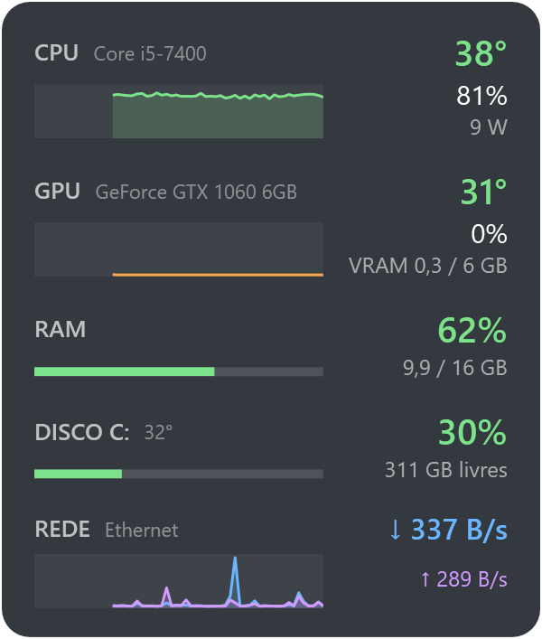

# Monitor de Hardware

Widget pra área de trabalho do Windows que mostra em tempo real como o PC está: **temperatura e uso da CPU e da placa de vídeo, memória RAM, espaço em disco e velocidade da rede**, com um mini-gráfico do último minuto.

É só PowerShell + WPF, sem compilar nada. Os sensores são lidos com a biblioteca do **[LibreHardwareMonitor](https://github.com/LibreHardwareMonitor/LibreHardwareMonitor)**, carregada direto no script, então não precisa deixar o programa dele aberto.

<p align="center"></p>

## O que aparece

| | |
|---|---|
| **CPU** | temperatura, uso total (com gráfico) e consumo em watts |
| **GPU** | temperatura, uso (com gráfico) e VRAM usada. Se tiver placa dedicada (NVIDIA/AMD), ela tem prioridade sobre a integrada |
| **RAM** | porcentagem usada e GB usados / total |
| **Disco** | espaço usado no disco do Windows e temperatura (SMART) do disco mais quente. Passa o mouse pra ver todos |
| **Rede** | download e upload da placa principal, com os dois no mesmo gráfico |

Os números mudam de cor conforme sobem: **verde**, **amarelo** e **vermelho**.

Dá pra arrastar pela tela, tem "sempre no topo" no botão direito e ele lembra onde ficou (`%APPDATA%\monitor-hardware.json`).

## Instalação

```powershell
git clone https://github.com/victormorais07/monitor-hardware.git
cd monitor-hardware
powershell -ExecutionPolicy Bypass -File .\instalar.ps1
```

O instalador:

1. baixa o LibreHardwareMonitor **0.9.6** do GitHub oficial pra pasta `lib` e **confere o hash SHA-256** do arquivo antes de usar
2. cria a tarefa agendada **"Monitor de Hardware"**, que abre o widget como administrador
3. cria o atalho **"Monitor de Hardware"** no Menu Iniciar

Pra abrir junto com o Windows:

```powershell
.\instalar.ps1 -IniciarComWindows
```

Pra remover a tarefa e o atalho: `.\instalar.ps1 -Desinstalar`

### Por que precisa de administrador?

A temperatura da CPU vem de registradores do processador (MSR), que o Windows só deixa ler com privilégio de administrador e um driver. O LibreHardwareMonitor usa o driver **[PawnIO](https://pawnio.eu)**; se ele não estiver instalado, o instalador avisa:

```powershell
winget install namazso.PawnIO
```

Pra não aparecer a tela do UAC toda vez, o atalho do Menu Iniciar não abre o script direto: ele dispara a tarefa agendada, que já está configurada pra rodar com privilégio máximo. Rodando sem admin (`monitor.ps1 -SemAdmin`) tudo funciona, menos as temperaturas da CPU e dos discos.

## Alguns detalhes

- **Gráficos:** são um `Polyline` (a linha) e um `Polygon` (o preenchimento) do WPF redesenhados a cada segundo, sem biblioteca de gráfico
- **Rede:** o PC pode ter várias placas (Wi-Fi, Ethernet, VPN, Bluetooth). Somar todas contaria duas vezes o tráfego da VPN, que também passa pela placa física, então o widget mostra a placa que mais trafegou desde que o PC ligou
- **Discos:** ler o SMART é mais lento, então os discos atualizam a cada 10 segundos e o resto a cada 1 segundo
- **Uma instância só:** um `Mutex` impede de abrir dois widgets iguais
- **Posição salva:** se você desconectar o segundo monitor, ele volta pro canto em vez de abrir fora da tela

## Arquivos

| Arquivo | Pra que serve |
|---|---|
| `monitor.ps1` | o widget |
| `instalar.ps1` | baixa a biblioteca, cria a tarefa agendada e o atalho |
| `Iniciar-Monitor.vbs` | abre o PowerShell escondido, sem a janela preta |

> Testado no Windows 10 com Intel Core i5-7400 e GeForce GTX 1060.

## Licença

[MIT](LICENSE). O LibreHardwareMonitor não vem no repositório: ele é baixado pelo instalador e tem a sua própria licença ([MPL-2.0](https://github.com/LibreHardwareMonitor/LibreHardwareMonitor/blob/master/LICENSE)).
